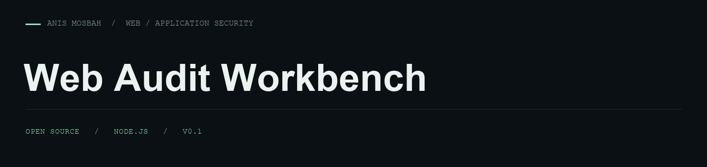
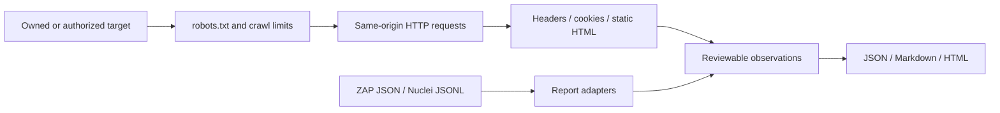

# Web Audit Workbench

### A bounded web audit. Evidence you can act on.

**Node.js 22+** · **MIT** · **v0.1.0** · [API](index.mjs) · [Tests](project.test.mjs)

A passive web crawler and findings workbench for **application security reviews**. Inspect HTTP response policy, identify risky cookie configuration, and bring ZAP or Nuclei output into the same readable reporting flow.

## What runs

| Capability | Behavior |
| :--- | :--- |
| Bounded crawl | One origin, explicit page/depth limits and delay between requests. |
| Robots policy | Reads robots.txt first, including matching user-agent rules. |
| Response checks | HTTPS, HSTS, CSP, framing, MIME sniffing and referrer policy. |
| Cookie checks | Secure, session-like HttpOnly and explicit SameSite handling. |
| Static HTML review | Same-origin links and apparent HTTP resource references. |
| Scanner adapters | Import ZAP JSON or Nuclei JSONL without raw traffic bodies. |
| Reports | Terminal, JSON, Markdown and standalone HTML. |

## Run a passive audit

```sh
git clone https://github.com/anistack72/web-audit-workbench.git
cd web-audit-workbench
node cli.mjs https://your-site.example --pages 10 --depth 2
node cli.mjs https://your-site.example --pages 20 --format html > web-audit.html
```

Use a site you own or are authorized to assess. Replace `your-site.example` with that target. Requires **Node.js 22+**; there are no runtime dependencies. Source distribution only; not published to npm.

## Work with established engines

```sh
node cli.mjs --import zap-report.json --source zap --format html > zap-review.html
node cli.mjs --import nuclei-results.jsonl --source nuclei --format markdown > nuclei-review.md
```

The adapters accept reports produced separately by [ZAP](https://www.zaproxy.org/docs/) and [Nuclei](https://docs.projectdiscovery.io/tools/nuclei/overview). They import rule identifiers, severity, names and a sanitized location. Query strings, URL credentials and raw request/response bodies are omitted. The workbench does **not** launch active scanner templates, exploit payloads or authenticated browser sessions.



## Operational boundaries

The default scan makes at most **10 page requests plus one robots.txt request**, depth **2**, with **200 ms** between page requests. Redirects never leave the selected origin and consume page budget. Links with query strings, credentials or obvious destructive-action paths are excluded. No cookies, authorization headers or form submissions are sent. If robots.txt cannot be established reliably, crawling stops. HTML bodies are limited to 1 MiB; report imports are limited to 25 MiB.

`--timeout` covers response and body reading. `--pages` accepts 1–100 and `--depth` 0–5. `--strict` fails on warnings. Exit codes: **0** no failed checks, **1** failed checks, **2** usage or import error.

## Interpret findings in context

Header presence is not proof of a safe policy. Cookie names are used only as a heuristic for session-related flags. The link extractor reads static HTML; JavaScript routes, API authorization, authenticated workflows, SQL injection, XSS exploitation and business logic are outside this crawler’s coverage. robots.txt support covers matching user-agent groups, Allow/Disallow, wildcards and terminal anchors; it is not a general-purpose search-engine crawler.

A report with no findings is not a security certification. The implementation and tests are independent of ZAP and ProjectDiscovery, whose engines and trademarks remain their own.

## Reproducible demonstration

```sh
node demo.mjs
node demo.mjs html > demo-report.html
```

The demo is explicitly labeled **synthetic**. It uses temporary local data or controlled fixture responses, never a third-party target. The generated HTML is standalone, with no remote scripts, fonts or analytics.

## Development

```sh
npm run check
npm test
```

Tests use local fixtures and local HTTP servers. The included CI matrix targets Node.js 22 and 24 on Linux, macOS and Windows. A local test pass does not mean that every CI platform has already run.

See [CONTRIBUTING.md](CONTRIBUTING.md) for changes and [SECURITY.md](SECURITY.md) for private security reports.

---

Built by **Anis Mosbah** · [Professional enquiries](mailto:contact@anis-mosbah.dev) · [MIT license](LICENSE)

## Reproducible walkthrough and releases

Follow the [synthetic-fixture walkthrough](docs/try-it.md) before using real inputs. The terminal, JSON and HTML paths are covered by subprocess tests. See [CHANGELOG.md](CHANGELOG.md) for release contents.

[GitHub releases](https://github.com/anistack72/web-audit-workbench/releases) distribute verified source tarballs and `SHA256SUMS.txt`; this package is not published to npm. Release publication runs automatically after the complete Node 22/24 matrix succeeds on Linux, macOS and Windows. Published versions are preserved. Daily scheduled tests create no commits or releases.
